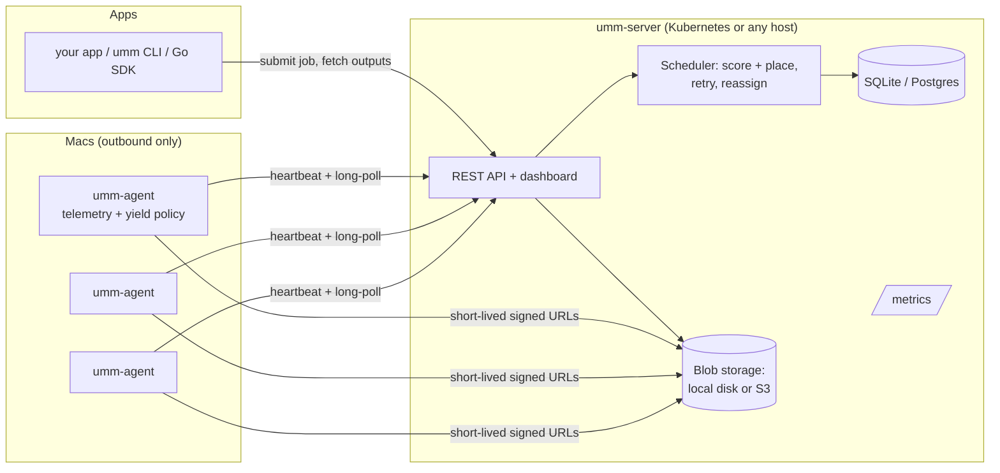

# use-my-mac

**Turn the Apple Silicon Macs you already have into a compute pool, without getting in anyone's way.**

`use-my-mac` (CLI: `umm`) is a small router plus an agent for macOS. Apps submit work over a REST API.
The router places each task on the best Mac for it: idle or locked Macs first, Macs that fit the
memory and GPU needs, AC power and cool ones over battery and hot ones. Work is spread across the fleet.
Staff Macs with someone logged in still count. When that person starts heavy work of their own, the agent
stops our task within seconds and the router moves it to another Mac.

- **Generic.** A task is an allowlisted program, its arguments, input files, output files and resource
  hints. A job is a set of tasks with optional dependencies (map, then reduce). The core has no video, OCR
  or ML code.
- **Native, not containers.** Tasks run as plain macOS processes, so they keep Metal, VideoToolbox and the
  Neural Engine. They run at background priority (`taskpolicy -b`) in a private work dir as a dedicated
  non-admin user.
- **Polite.** The agent watches the console user, HID idle time, screen lock, the user's own CPU (our
  processes excluded), memory pressure, thermal state and power source. Being logged in doesn't stop work.
  Sustained heavy use by the user does.
- **No inbound ports on Macs.** Agents connect outbound and long-poll. Enrolment uses a one-time token that
  is exchanged for a per-Mac credential.
- **Zero extra infra.** One Go binary with SQLite and local file storage. When you need more, add Postgres
  and any S3-compatible store (agents only ever get short-lived presigned URLs).
- **Observable.** Prometheus metrics, a dashboard (React + shadcn/ui) with live Mac telemetry, job progress,
  per-attempt history, logs and the reason each Mac was picked or skipped. Sign-in uses OIDC (Microsoft Entra
  ID preset included) with admin and viewer roles mapped from groups.

> Status: early. The router, scheduler and agent are covered by unit and integration tests on Linux, and the
> agent cross-compiles for `darwin/arm64`. The macOS telemetry collectors parse documented tool output but
> have **not yet been run on a real Mac**. See [What's verified](#whats-verified).

## How it works



1. An app submits a **job**: tasks with `runtime`, `args`, `inputs`, `outputs`, `resources` and
   `depends_on`.
2. The scheduler scores every Mac for every runnable task and assigns the best one. Hard filters cover
   offline, draining, quarantined, wrong runtime, not enough RAM or disk, critical thermal state and battery.
3. The agent picks up the task on its next long-poll. It downloads inputs into `in/` and runs
   `taskpolicy -b <allowlisted program> <args>`, streaming logs as it goes. Then it uploads `out/*`.
4. If the Mac's user goes heavy, the agent stops the task (SIGTERM, then SIGKILL) and reports `yielded`. The
   router reassigns it straight away. A yield doesn't count as a failure. Failures are retried with
   backoff on a different Mac, and lost heartbeats trigger reassignment.
5. When all map tasks succeed, the reduce task runs with their outputs as inputs.

Details: [docs/design.md](docs/design.md).

## Quickstart (local)

Requirements: Go 1.26+, Node 24+ (only for the dashboard).

```sh
make web build                 # dashboard + bin/umm-server, bin/umm, bin/umm-agent
export UMM_SECRET_KEY=$(openssl rand -hex 32)
./bin/umm-server admin-key create -config deploy/dev.yaml   # prints an admin key once
make run-dev                   # http://localhost:8080
```

Sign in to the dashboard with the admin key. Then from another shell:

```sh
export UMM_SERVER=http://localhost:8080
export UMM_API_KEY=umm_key_...           # the admin key (or create an app key: umm keys create my-app)
./bin/umm macs
```

### Add a Mac

```sh
make dist-mac                            # dist/umm-agent-darwin-arm64.tar.gz
# copy it to the Mac, unpack, then on the Mac:
sudo UMM_SERVER=https://umm.example.com sh install.sh
# paste the one-time token from the dashboard (Macs -> Add a Mac) or `umm enrol`
```

`install.sh` creates the hidden `_umm` service user and installs `/usr/local/bin/umm-agent`. It writes
`/usr/local/etc/umm/agent.yaml` (edit the `runtimes` allowlist there) and loads a LaunchDaemon. Anyone with
admin rights on the Mac can pause it with `sudo touch /usr/local/etc/umm/paused`. Check what the agent sees
with `umm-agent telemetry`.

### Submit work

```yaml
# job.yaml
name: encode
tasks:
  - key: part-1
    runtime: ffmpeg
    args: ["-i", "{in:src}", "-c:v", "hevc_videotoolbox", "-b:v", "8M", "{out:enc.mp4}"]
    inputs:  [{name: src, file: ./part-1.mov}]   # the CLI uploads local files
    outputs: [{name: enc.mp4}]
    resources: {ram_mb: 2048, gpu: true, expected_seconds: 120}
```

```sh
umm submit job.yaml -wait
umm status JOB_ID
umm download TASK_ID enc.mp4
```

More examples, including map/reduce video encoding with the Go SDK and batched OCR over plain REST, are in
[`examples/`](examples/).

## Deploy

- **Kubernetes:** Helm chart in [`deploy/helm/use-my-mac`](deploy/helm/use-my-mac). It runs a single
  replica on a PVC with optional external Postgres, S3 storage, a Gateway API `HTTPRoute` and a
  `ServiceMonitor`. Secrets come from an existing Secret and are never rendered by the chart.
- **Container:** `docker build -t use-my-mac .` builds a distroless, non-root image with the dashboard
  included.
- **Config reference:** [`deploy/server.example.yaml`](deploy/server.example.yaml),
  [`deploy/mac/agent.example.yaml`](deploy/mac/agent.example.yaml).

## API at a glance

| | |
| --- | --- |
| `POST /v1/jobs` | submit a job (app/admin) |
| `GET /v1/jobs`, `GET /v1/jobs/{id}` | list / inspect (apps only see their own jobs) |
| `POST /v1/jobs/{id}/cancel` | cancel |
| `GET /v1/tasks/{id}` | attempts, placement scores |
| `GET /v1/tasks/{id}/logs` | logs (all attempts) |
| `GET /v1/tasks/{id}/outputs/{name}` | download an output |
| `PUT /v1/blobs/{key}` | upload an input |
| `GET /v1/macs`, `PATCH /v1/macs/{id}` | fleet, drain / opt-out (admin) |
| `POST /v1/enrolment-tokens` | one-time Mac enrolment token (admin) |
| `GET/POST/DELETE /v1/api-keys` | app keys (admin) |
| `GET/PUT /v1/settings` | scheduler weights and limits |
| `GET /metrics` | Prometheus |

Authenticate with `Authorization: Bearer umm_key_...`.

## What's verified

| Area | Status |
| --- | --- |
| Scorer, yield state machine, retry/backoff, quarantine, DAG + reduce, storage (local + S3 SigV4 against AWS's test vector), OIDC role mapping | unit tests |
| Router + real agents running real processes, with simulated telemetry: a user goes heavy mid-task and the task moves to another Mac; map/reduce completes across two Macs; a crash retries on another Mac; auth boundaries | integration tests |
| SQLite and Postgres stores | tests (Postgres in CI) |
| macOS collectors (`ioreg`, `ps`, `vm_stat`, `pmset`, `sysctl`, `df`) | parsers tested on sample output; **not yet run on a Mac** |
| `install.sh`, LaunchDaemon, `taskpolicy`, `sandbox-exec`, VideoToolbox from a daemon user | **not yet run on a Mac** |
| OIDC login against a live Entra tenant | **not yet tested** |

## Contributing

See [CONTRIBUTING.md](CONTRIBUTING.md). Licensed under the [Apache License 2.0](LICENSE).
